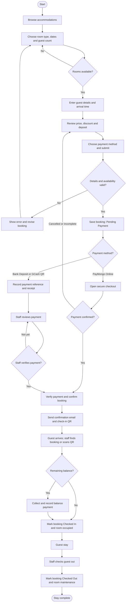
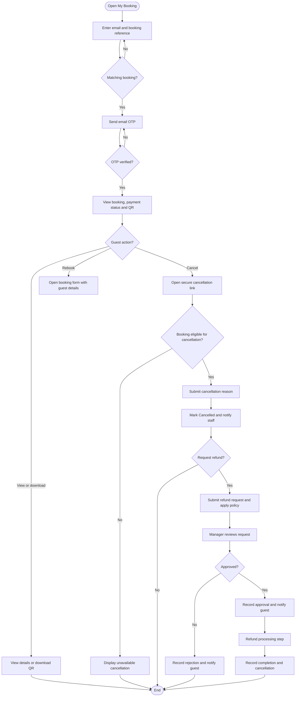
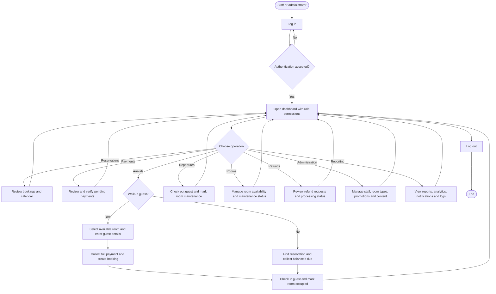

# Santa Beach Club Booking System — Project Flowcharts

Based on the current PHP implementation. These diagrams summarize the main user journeys; they do not describe every validation or error handler. Open in a Markdown viewer with Mermaid support.

## 1. Online reservation and guest stay

Manual payment evidence is collected in the booking form before the pending booking is saved; its review is shown separately for readability. PayMongo confirmation is handled by the return page and webhook. The staff checkout page also marks verified payment revenue as earned.

## 2. Guest portal, cancellation and refund request

The secure cancellation link can also be opened directly from the booking email. Cancellation accepts Pending, Pending Payment or Confirmed bookings. Refund completion here describes application status changes: the current refund endpoint contains a simulated processing step and is not proof that a payment provider has transferred funds.

## 3. Staff and administrator operations

## Implementation references

- Booking and payment: `frontend/book.php`, `frontend/payments.php`, `frontend/payment_success.php`, `backend/api/paymongo_webhook.php`.
- Guest access: `frontend/my_booking.php`, `backend/api/guest_lookup_api.php`, `backend/api/guest_verify_otp_api.php`.
- Cancellation and refunds: `frontend/cancel_booking.php`, `backend/api/refund_request_api.php`.
- Arrival and departure: `frontend/checkin.php`, `frontend/checkout.php`, `frontend/admin_checkin.php`, `frontend/admin_checkout.php`.
